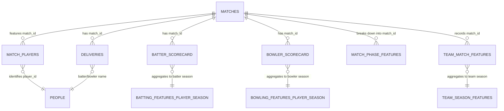

# IPL ANALYTICS PLATFORM — COMPREHENSIVE PROJECT DATA DICTIONARY

**Generated on:** 2026-11-09  
**Dataset Source:** Cleaned + Feature-Engineered IPL Datasets (Stage 2 Integrated & Stage 4 Insights)  
**Coverage:** 19 IPL Seasons (2007/08 to 2026), 1,243 completed/scheduled matches, 295,732 ball-by-ball deliveries.  

## 1. Overview of Available Datasets

| Category | Dataset File | Grain / Entity | Rows | Columns | Description |
|---|---|---|---|---|---|
| Base | `base/matches.csv` | Match grain | 1,243 | 45 | Match metadata, toss, result, innings totals, winner |
| Base | `base/deliveries.csv` | Ball / Delivery grain | 295,732 | 41 | Ball-by-ball events, runs, extras, wickets, phase, dots |
| Base | `base/batter_scorecard.csv` | Batter-Innings grain | 18,837 | 44 | Individual batting innings performance, milestones, strike rates |
| Base | `base/bowler_scorecard.csv` | Bowler-Innings grain | 14,734 | 40 | Individual bowling figures, wickets, economy, dots, maidens |
| Base | `base/match_players.csv` | Match-Player grain | 27,909 | 4 | Playing XI records connecting match, team, and player |
| Base | `base/people.csv` | Player identity grain | 17,851 | 22 | Master player identifiers, cricinfo/bcci mappings, DOB |
| Base | `base/squads.csv` | Squad-Player grain | 257 | 9 | Current squad rosters, roles, batting/bowling styles |
| Base | `base/ipl_2026_schedule.csv` | Fixture grain | 74 | 7 | Official schedule fixtures for season 2026 |
| Analytics | `analytics/batting_features_player_season.csv` | Player-Season grain | 2,959 | 17 | Season-aggregated batting metrics, avg, SR, 50s, 100s |
| Analytics | `analytics/bowling_features_player_season.csv` | Player-Season grain | 2,201 | 15 | Season-aggregated bowling metrics, avg, economy, SR |
| Analytics | `analytics/match_innings_features.csv` | Match-Innings grain | 2,514 | 20 | Innings summary, run rates, boundary rates, extras |
| Analytics | `analytics/match_phase_features.csv` | Match-Phase grain | 7,338 | 16 | Phase breakdown (powerplay, middle, death) per innings |
| Analytics | `analytics/team_match_features.csv` | Team-Match grain | 2,514 | 30 | Team performance per match, chase/defend flags, margin |
| Analytics | `analytics/team_season_features.csv` | Team-Season grain | 166 | 13 | Team performance aggregated per season |
| Stage 4 | `stage4/player_batting_leaderboard.csv` | Career Batter grain | 738 | 14 | All-time batting career totals, average, SR, 50s, 100s |
| Stage 4 | `stage4/player_bowling_leaderboard.csv` | Career Bowler grain | 577 | 12 | All-time bowling career totals, wickets, economy, average |
| Stage 4 | `stage4/team_overall_performance.csv` | Team All-Time grain | 19 | 8 | All-time franchise win %, matches, avg score, run rate |
| Stage 4 | `stage4/team_season_performance.csv` | Team-Season grain | 166 | 13 | Verified season-by-season performance per team |
| Stage 4 | `stage4/venue_scoring_insights.csv` | Venue grain | 53 | 9 | Venue averages, median score, run rates, wickets, sixes |
| Stage 4 | `stage4/season_trends.csv` | Season grain | 19 | 5 | Season-over-season progression in run rates, totals |
| Stage 4 | `stage4/phase_performance.csv` | Phase grain | 3 | 9 | Macro comparison of Powerplay, Middle, Death overs |
| Stage 4 | `stage4/batter_consistency.csv` | Career Consistency | 382 | 7 | Mean runs/season, std dev, coefficient of variation (CV%) |
| Stage 4 | `stage4/bowler_consistency.csv` | Career Consistency | 294 | 7 | Mean wickets/season, std dev, CV%, economy stability |
| Stage 4 | `stage4/team_batting_first_vs_chasing.csv` | Team Strategy | 19 | 7 | Win rate defending vs chasing per team |
| Stage 4 | `stage4/first_innings_score_vs_chase_success.csv`| Score Band | 6 | 4 | Chase win probability by 1st innings score bracket |
| Stage 4 | `stage4/chase_vs_defend_summary.csv` | Macro Strategy | 1 | 5 | Overall league-wide toss/chasing win distribution |

## 2. Primary Keys, Foreign Keys, and Entity Relationships

### Primary Keys by Table:
- `matches`: `match_id` (Integer) or `filename` (e.g., `335982.json` / `1473650.json`)
- `deliveries`: Composite (`match_id`, `innings`, `over`, `ball`)
- `batter_scorecard`: Composite (`match_id`, `innings`, `batter`)
- `bowler_scorecard`: Composite (`match_id`, `innings`, `bowler`)
- `match_players`: Composite (`filename`, `player_id`)
- `people`: `identifier` (String UUID/hash)
- `match_phase_features`: Composite (`match_id`, `innings`, `phase`)
- `team_match_features`: Composite (`match_id`, `innings`, `team`)
- `batting_features_player_season`: Composite (`season`, `batter`)
- `bowling_features_player_season`: Composite (`season`, `bowler`)
- `team_season_features`: Composite (`season`, `team`)

## 3. Detailed Column Schemas & Data Types

### `base/batter_scorecard.csv` (18837 records)

| Column Name | Data Type | Sample Values |
|---|---|---|
| `match_id` | int64 | `335982`, `335982` |
| `date` | str | `2008-04-18`, `2008-04-18` |
| `venue` | str | `M Chinnaswamy Stadium`, `M Chinnaswamy Stadium` |
| `city` | str | `Bangalore`, `Bangalore` |
| `season` | str | `2007/08`, `2007/08` |
| `batting_team` | str | `Kolkata Knight Riders`, `Kolkata Knight Riders` |
| `bowling_team` | str | `Royal Challengers Bangalore`, `Royal Challengers Bangalore` |
| `innings` | int64 | `1`, `1` |
| `batting_position` | int64 | `1`, `2` |
| `batter` | str | `SC Ganguly`, `BB McCullum` |
| `entry_score` | int64 | `0`, `1` |
| `entry_wickets` | int64 | `0`, `0` |
| `entry_over` | int64 | `1`, `1` |
| `entry_bowler` | str | `P Kumar`, `P Kumar` |
| `total_runs` | int64 | `10`, `158` |
| `total_balls_faced` | int64 | `12`, `73` |
| `fours` | int64 | `2`, `10` |
| `sixes` | int64 | `0`, `13` |
| `strike_rate` | float64 | `83.33`, `216.44` |
| `runs_after_5_balls` | float64 | `0.0`, `0.0` |
| `runs_after_10_balls` | float64 | `10.0`, `18.0` |
| `runs_after_20_balls` | float64 | `41.0`, `20.0` |
| `runs_after_30_balls` | float64 | `47.0`, `48.0` |
| `runs_after_40_balls` | float64 | `67.0`, `68.0` |
| `runs_after_50_balls` | float64 | `89.0`, `100.0` |
| `out` | bool | `True`, `False` |
| `dismissal_kind` | str | `caught`, `caught` |
| `dismissal_bowler` | str | `Z Khan`, `JH Kallis` |
| `dismissal_fielder` | str | `JH Kallis`, `P Kumar` |
| `boundary_runs` | int64 | `8`, `118` |
| `non_boundary_runs` | int64 | `2`, `40` |
| `boundary_percentage` | float64 | `80.0`, `74.68` |
| `dot_ball_percentage_est` | float64 | _null_ |
| `balls_per_boundary` | float64 | `6.0`, `3.17` |
| `runs_per_ball` | float64 | `0.833`, `2.164` |
| `calculated_strike_rate` | float64 | `83.3`, `216.4` |
| `boundary_count` | int64 | `2`, `23` |
| `dismissed_flag` | int64 | `1`, `0` |
| `not_out_flag` | int64 | `0`, `1` |
| `entry_phase` | str | `Powerplay`, `Powerplay` |
| `high_impact_30_plus` | int64 | `0`, `1` |
| `half_century_flag` | int64 | `0`, `1` |
| `century_flag` | int64 | `0`, `1` |
| `season_player_key` | str | `2007/08|SC Ganguly`, `2007/08|BB McCullum` |

### `base/bowler_scorecard.csv` (14734 records)

| Column Name | Data Type | Sample Values |
|---|---|---|
| `match_id` | int64 | `335982`, `335982` |
| `date` | str | `2008-04-18`, `2008-04-18` |
| `venue` | str | `M Chinnaswamy Stadium`, `M Chinnaswamy Stadium` |
| `city` | str | `Bangalore`, `Bangalore` |
| `season` | str | `2007/08`, `2007/08` |
| `batting_team` | str | `Kolkata Knight Riders`, `Kolkata Knight Riders` |
| `bowling_team` | str | `Royal Challengers Bangalore`, `Royal Challengers Bangalore` |
| `innings` | int64 | `1`, `1` |
| `bowler` | str | `AA Noffke`, `CL White` |
| `balls` | int64 | `24`, `6` |
| `overs` | float64 | `4.0`, `1.0` |
| `runs` | int64 | `40`, `24` |
| `extras` | int64 | `5`, `2` |
| `wides` | int64 | `5`, `2` |
| `noballs` | int64 | `0`, `0` |
| `fours_conceded` | int64 | `2`, `2` |
| `sixes_conceded` | int64 | `2`, `2` |
| `dot_balls` | int64 | `7`, `0` |
| `maidens` | int64 | `0`, `0` |
| `wickets` | int64 | `1`, `0` |
| `economy_rate` | float64 | `10.0`, `24.0` |
| `strike_rate` | float64 | `24.0`, `24.0` |
| `wickets_caught` | int64 | `1`, `0` |
| `wickets_caught_and_bowled` | int64 | `0`, `0` |
| `wickets_bowled` | int64 | `0`, `0` |
| `wickets_lbw` | int64 | `0`, `0` |
| `wickets_stumped` | int64 | `0`, `0` |
| `wickets_hit_wicket` | int64 | `0`, `0` |
| `run_outs` | int64 | `0`, `0` |
| `legal_balls` | int64 | `19`, `4` |
| `overs_calculated` | float64 | `3.1`, `0.4` |
| `economy_calculated` | float64 | `12.63`, `36.0` |
| `dot_ball_percentage` | float64 | `36.84`, `0.0` |
| `boundary_runs_conceded` | int64 | `20`, `20` |
| `boundary_percentage_of_runs` | float64 | `50.0`, `83.33` |
| `balls_per_wicket` | float64 | `19.0`, `23.0` |
| `runs_per_wicket` | float64 | `40.0`, `48.0` |
| `wicket_flag` | int64 | `1`, `0` |
| `three_wicket_haul` | int64 | `0`, `0` |
| `four_wicket_haul` | int64 | `0`, `0` |

### `base/deliveries.csv` (295732 records)

| Column Name | Data Type | Sample Values |
|---|---|---|
| `match_id` | int64 | `1082591`, `1082591` |
| `date` | str | `2017-04-05`, `2017-04-05` |
| `venue` | str | `Rajiv Gandhi International Stadium, Uppal`, `Rajiv Gandhi International Stadium, Uppal` |
| `city` | str | `Hyderabad`, `Hyderabad` |
| `team1` | str | `Sunrisers Hyderabad`, `Sunrisers Hyderabad` |
| `team2` | str | `Royal Challengers Bangalore`, `Royal Challengers Bangalore` |
| `season` | int64 | `2017`, `2017` |
| `innings` | int64 | `1`, `1` |
| `batting_team` | str | `Sunrisers Hyderabad`, `Sunrisers Hyderabad` |
| `bowling_team` | str | `Royal Challengers Bangalore`, `Royal Challengers Bangalore` |
| `over` | int64 | `1`, `1` |
| `ball` | int64 | `1`, `2` |
| `batter` | str | `DA Warner`, `DA Warner` |
| `bowler` | str | `TS Mills`, `TS Mills` |
| `non_striker` | str | `S Dhawan`, `S Dhawan` |
| `batter_runs` | int64 | `0`, `0` |
| `extras_total` | int64 | `0`, `0` |
| `total_runs` | int64 | `0`, `0` |
| `wides` | int64 | `0`, `0` |
| `noballs` | int64 | `0`, `0` |
| `byes` | int64 | `0`, `0` |
| `legbyes` | int64 | `0`, `0` |
| `penalty` | int64 | `0`, `0` |
| `is_wicket` | int64 | `0`, `0` |
| `is_retired` | float64 | `0.0`, `0.0` |
| `player_out` | str | `DA Warner`, `S Dhawan` |
| `dismissal_kind` | str | `caught`, `caught` |
| `fielder` | str | `Mandeep Singh`, `Sachin Baby` |
| `sub_type` | float64 | _null_ |
| `sub_in` | float64 | _null_ |
| `sub_out` | float64 | _null_ |
| `sub_reason` | float64 | _null_ |
| `sub_role` | float64 | _null_ |
| `legal_delivery` | int64 | `1`, `1` |
| `batter_ball_faced` | int64 | `1`, `1` |
| `boundary_4` | int64 | `0`, `0` |
| `boundary_6` | int64 | `0`, `0` |
| `boundary_runs` | int64 | `0`, `0` |
| `phase` | str | `Powerplay`, `Powerplay` |
| `is_dot_ball` | int64 | `1`, `1` |
| `wicket_excluding_runout` | int64 | `0`, `0` |

### `base/ipl_2026_schedule.csv` (74 records)

| Column Name | Data Type | Sample Values |
|---|---|---|
| `match_no` | int64 | `1`, `2` |
| `date` | str | `2026-03-28`, `2026-03-29` |
| `day` | str | `Sat`, `Sun` |
| `start_time` | str | `7:30 PM`, `7:30 PM` |
| `home_team` | str | `Royal Challengers Bengaluru`, `Mumbai Indians` |
| `away_team` | str | `Sunrisers Hyderabad`, `Kolkata Knight Riders` |
| `venue` | str | `Bengaluru`, `Mumbai` |

### `base/matches.csv` (1243 records)

| Column Name | Data Type | Sample Values |
|---|---|---|
| `filename` | str | `335982.yaml`, `335983.yaml` |
| `season` | str | `2007/08`, `2007/08` |
| `match_number` | float64 | `1.0`, `2.0` |
| `date` | str | `2008-04-18`, `2008-04-19` |
| `team1` | str | `Royal Challengers Bangalore`, `Kings XI Punjab` |
| `team2` | str | `Kolkata Knight Riders`, `Chennai Super Kings` |
| `city` | str | `Bangalore`, `Chandigarh` |
| `venue` | str | `M Chinnaswamy Stadium`, `Punjab Cricket Association Stadium, Mohali` |
| `neutral_venue` | float64 | `1.0`, `1.0` |
| `toss_winner` | str | `Royal Challengers Bangalore`, `Chennai Super Kings` |
| `toss_decision` | str | `field`, `bat` |
| `winner` | str | `Kolkata Knight Riders`, `Chennai Super Kings` |
| `win_type` | str | `runs`, `runs` |
| `win_margin` | float64 | `140.0`, `33.0` |
| `result` | str | `tie`, `tie` |
| `method` | str | `D/L`, `D/L` |
| `eliminator` | str | `Rajasthan Royals`, `Kings XI Punjab` |
| `player_of_match` | str | `BB McCullum`, `MEK Hussey` |
| `umpire1` | str | `Asad Rauf`, `MR Benson` |
| `umpire2` | str | `RE Koertzen`, `SL Shastri` |
| `event_stage` | str | `Semi Final`, `Semi Final` |
| `target_overs` | float64 | `20.0`, `20.0` |
| `target_runs` | float64 | `223.0`, `241.0` |
| `match_referee` | str | `J Srinath`, `S Venkataraghavan` |
| `tv_umpire` | str | `AM Saheba`, `RB Tiffin` |
| `reserve_umpire` | str | `VN Kulkarni`, `MSS Ranawat` |
| `team1_impact_in` | str | `TU Deshpande`, `R Dhawan` |
| `team1_impact_out` | str | `AT Rayudu`, `PBB Rajapaksa` |
| `team2_impact_in` | str | `B Sai Sudharsan`, `VR Iyer` |
| `team2_impact_out` | str | `KS Williamson`, `CV Varun` |
| `match_id` | int64 | `335982`, `335983` |
| `innings_1_runs` | float64 | `222.0`, `240.0` |
| `innings_2_runs` | float64 | `82.0`, `207.0` |
| `innings_3_runs` | float64 | `15.0`, `9.0` |
| `innings_4_runs` | float64 | `18.0`, `10.0` |
| `innings_5_runs` | float64 | `11.0` |
| `innings_6_runs` | float64 | `15.0` |
| `first_innings_score` | float64 | `222.0`, `240.0` |
| `second_innings_score` | float64 | `82.0`, `207.0` |
| `run_difference_innings` | float64 | `140.0`, `33.0` |
| `chase_target` | float64 | `223.0`, `241.0` |
| `chase_result_runs` | float64 | `-141.0`, `-34.0` |
| `toss_winner_won_match` | object | `False`, `True` |
| `toss_decision_bat_first` | int64 | `0`, `1` |
| `is_no_result_or_tie` | int64 | `0`, `0` |

### `base/match_players.csv` (27909 records)

| Column Name | Data Type | Sample Values |
|---|---|---|
| `filename` | str | `335982.yaml`, `335982.yaml` |
| `team` | str | `Kolkata Knight Riders`, `Kolkata Knight Riders` |
| `player_name` | str | `AB Agarkar`, `AB Dinda` |
| `player_id` | str | `fa463154`, `66b30f71` |

### `base/people.csv` (17851 records)

| Column Name | Data Type | Sample Values |
|---|---|---|
| `identifier` | str | `b4a23876`, `482762af` |
| `name` | str | `AAA Amsterdam`, `AA Adeoye` |
| `unique_name` | str | `AAA Amsterdam`, `AA Adeoye` |
| `key_bcci` | str | `i0X1KhUIJLIzQOiJAiebGCiVyJJeiOc`, `KVGiiAJbJeyiJCIeiXLzJ1OcO0UihIQ` |
| `key_bcci_2` | str | `JiKiGIeIUAV0hzOiiLQJ1XycCJbJOei` |
| `key_bigbash` | float64 | `3241.0`, `5358.0` |
| `key_cricbuzz` | float64 | `7625.0` |
| `key_cricheroes` | float64 | `3520831.0`, `9130435.0` |
| `key_crichq` | float64 | _null_ |
| `key_cricinfo` | float64 | `772407.0`, `380588.0` |
| `key_cricinfo_2` | float64 | `1048889.0`, `1241315.0` |
| `key_cricinfo_3` | float64 | _null_ |
| `key_cricingif` | float64 | `13732.0`, `23724.0` |
| `key_cricketarchive` | float64 | `1512811.0`, `2010.0` |
| `key_cricketarchive_2` | float64 | _null_ |
| `key_cricketworld` | float64 | `120019.0`, `94563.0` |
| `key_nvplay` | str | `336f1b69-2fc6-43be-bbaf-2e7669ee3810`, `0ad52976-7c00-4704-95a8-f6e267ec7646` |
| `key_nvplay_2` | float64 | _null_ |
| `key_opta` | float64 | `3006.0`, `17108.0` |
| `key_opta_2` | float64 | _null_ |
| `key_pulse` | float64 | `18542.0`, `138.0` |
| `key_pulse_2` | float64 | `2691.0` |

### `base/squads.csv` (257 records)

| Column Name | Data Type | Sample Values |
|---|---|---|
| `name` | str | `Axar Patel`, `Abishek Porel` |
| `team` | str | `Delhi Capitals`, `Delhi Capitals` |
| `cricinfo_player_id` | int64 | `554691`, `1277545` |
| `url` | str | `https://www.espncricinfo.com/cricketers/axar-patel-554691`, `https://www.espncricinfo.com/cricketers/abishek-porel-1277545` |
| `role` | str | `Allrounder`, `Wicketkeeper Batter` |
| `batting_style` | str | `Left hand Bat`, `Left hand Bat` |
| `bowling_style` | str | `Slow Left arm Orthodox`, `Right arm Medium` |
| `picture_url` | str | `https://img1.hscicdn.com/image/upload/f_auto,t_h_100/lsci/db/PICTURES/CMS/331100/331164.2.png`, `https://img1.hscicdn.com/image/upload/f_auto,t_h_100/lsci/db/PICTURES/CMS/393400/393462.2.png` |
| `age` | int64 | `32`, `23` |

### `analytics/batting_features_player_season.csv` (2959 records)

| Column Name | Data Type | Sample Values |
|---|---|---|
| `season` | str | `2007/08`, `2007/08` |
| `batter` | str | `A Chopra`, `A Kumble` |
| `innings` | int64 | `5`, `4` |
| `runs` | int64 | `42`, `13` |
| `balls_faced` | int64 | `52`, `17` |
| `fours` | int64 | `5`, `1` |
| `sixes` | int64 | `0`, `0` |
| `dismissals` | int64 | `5`, `2` |
| `not_outs` | int64 | `0`, `2` |
| `fifties` | int64 | `0`, `0` |
| `hundreds` | int64 | `0`, `0` |
| `average_strike_rate` | float64 | `62.5`, `85.725` |
| `matches` | int64 | `5`, `4` |
| `batting_average` | float64 | `8.4`, `6.5` |
| `strike_rate` | float64 | `80.77`, `76.47` |
| `boundary_runs` | int64 | `20`, `4` |
| `boundary_percentage` | float64 | `47.62`, `30.77` |

### `analytics/bowling_features_player_season.csv` (2201 records)

| Column Name | Data Type | Sample Values |
|---|---|---|
| `season` | str | `2007/08`, `2007/08` |
| `bowler` | str | `A Kumble`, `A Mishra` |
| `innings_bowled` | int64 | `10`, `6` |
| `matches` | int64 | `10`, `6` |
| `legal_balls` | int64 | `220`, `116` |
| `runs_conceded` | int64 | `304`, `138` |
| `wickets` | int64 | `7`, `11` |
| `dot_balls` | int64 | `91`, `45` |
| `fours_conceded` | int64 | `27`, `4` |
| `sixes_conceded` | int64 | `14`, `8` |
| `maidens` | int64 | `0`, `0` |
| `economy` | float64 | `8.29`, `7.14` |
| `bowling_average` | float64 | `43.43`, `12.55` |
| `bowling_strike_rate` | float64 | `31.43`, `10.55` |
| `dot_ball_percentage` | float64 | `41.36`, `38.79` |

### `analytics/match_innings_features.csv` (2514 records)

| Column Name | Data Type | Sample Values |
|---|---|---|
| `match_id` | int64 | `335982`, `335982` |
| `date` | str | `2008-04-18`, `2008-04-18` |
| `season` | str | `2007/08`, `2007/08` |
| `innings` | int64 | `1`, `2` |
| `batting_team` | str | `Kolkata Knight Riders`, `Royal Challengers Bangalore` |
| `bowling_team` | str | `Royal Challengers Bangalore`, `Kolkata Knight Riders` |
| `innings_runs` | int64 | `222`, `82` |
| `batter_runs` | int64 | `205`, `63` |
| `wickets` | int64 | `3`, `10` |
| `legal_balls` | int64 | `120`, `91` |
| `extras` | int64 | `17`, `19` |
| `fours` | int64 | `15`, `3` |
| `sixes` | int64 | `14`, `3` |
| `dot_balls` | int64 | `36`, `50` |
| `overs` | float64 | `20.0`, `15.1` |
| `run_rate` | float64 | `11.1`, `5.41` |
| `boundary_runs` | int64 | `144`, `30` |
| `boundary_percentage` | float64 | `64.86`, `36.59` |
| `dot_ball_percentage` | float64 | `30.0`, `54.95` |
| `innings_complete_or_partial` | str | `20-over-or-more`, `short/partial` |

### `analytics/match_phase_features.csv` (7338 records)

| Column Name | Data Type | Sample Values |
|---|---|---|
| `match_id` | int64 | `335982`, `335982` |
| `date` | str | `2008-04-18`, `2008-04-18` |
| `season` | str | `2007/08`, `2007/08` |
| `innings` | int64 | `1`, `1` |
| `batting_team` | str | `Kolkata Knight Riders`, `Kolkata Knight Riders` |
| `bowling_team` | str | `Royal Challengers Bangalore`, `Royal Challengers Bangalore` |
| `phase` | str | `Death`, `Middle` |
| `runs` | int64 | `68`, `93` |
| `wickets` | int64 | `1`, `1` |
| `legal_balls` | int64 | `30`, `54` |
| `fours` | int64 | `3`, `5` |
| `sixes` | int64 | `6`, `5` |
| `dot_balls` | int64 | `7`, `12` |
| `run_rate` | float64 | `13.6`, `10.33` |
| `economy_like_rate` | float64 | `13.6`, `10.33` |
| `dot_ball_percentage` | float64 | `23.33`, `22.22` |

### `analytics/team_match_features.csv` (2514 records)

| Column Name | Data Type | Sample Values |
|---|---|---|
| `match_id` | int64 | `335982`, `335982` |
| `date` | str | `2008-04-18`, `2008-04-18` |
| `season` | str | `2007/08`, `2007/08` |
| `innings` | int64 | `1`, `2` |
| `team` | str | `Kolkata Knight Riders`, `Royal Challengers Bangalore` |
| `opponent` | str | `Royal Challengers Bangalore`, `Kolkata Knight Riders` |
| `innings_runs` | int64 | `222`, `82` |
| `batter_runs` | int64 | `205`, `63` |
| `wickets` | int64 | `3`, `10` |
| `legal_balls` | int64 | `120`, `91` |
| `extras` | int64 | `17`, `19` |
| `fours` | int64 | `15`, `3` |
| `sixes` | int64 | `14`, `3` |
| `dot_balls` | int64 | `36`, `50` |
| `overs` | float64 | `20.0`, `15.1` |
| `run_rate` | float64 | `11.1`, `5.41` |
| `boundary_runs` | int64 | `144`, `30` |
| `boundary_percentage` | float64 | `64.86`, `36.59` |
| `dot_ball_percentage` | float64 | `30.0`, `54.95` |
| `innings_complete_or_partial` | str | `20-over-or-more`, `short/partial` |
| `winner` | str | `Kolkata Knight Riders`, `Kolkata Knight Riders` |
| `toss_winner` | str | `Royal Challengers Bangalore`, `Royal Challengers Bangalore` |
| `toss_decision` | str | `field`, `field` |
| `venue` | str | `M Chinnaswamy Stadium`, `M Chinnaswamy Stadium` |
| `city` | str | `Bangalore`, `Bangalore` |
| `date_meta` | str | `2008-04-18`, `2008-04-18` |
| `won_match` | int64 | `1`, `0` |
| `batting_first` | int64 | `1`, `0` |
| `won_batting_first` | int64 | `1`, `0` |
| `won_chasing` | int64 | `0`, `0` |

### `analytics/team_season_features.csv` (166 records)

| Column Name | Data Type | Sample Values |
|---|---|---|
| `season` | str | `2007/08`, `2007/08` |
| `team` | str | `Chennai Super Kings`, `Deccan Chargers` |
| `matches` | int64 | `16`, `14` |
| `wins` | int64 | `9`, `2` |
| `total_runs` | int64 | `2520`, `2229` |
| `average_score` | float64 | `157.5`, `159.21428571428572` |
| `average_wickets` | float64 | `4.9375`, `6.642857142857143` |
| `average_run_rate` | float64 | `8.3775`, `8.403571428571428` |
| `batting_first_matches` | int64 | `9`, `8` |
| `batting_first_wins` | int64 | `4`, `0` |
| `chasing_wins` | int64 | `5`, `2` |
| `win_percentage` | float64 | `56.25`, `14.29` |
| `batting_first_win_percentage` | float64 | `44.44`, `0.0` |

### `stage4/batter_consistency.csv` (382 records)

| Column Name | Data Type | Sample Values |
|---|---|---|
| `batter` | str | `KK Cooper`, `Ashutosh Sharma` |
| `seasons` | int64 | `3`, `3` |
| `mean_runs_per_season` | float64 | `38.666666666666664`, `188.0` |
| `std_runs_per_season` | float64 | `0.5773502691896263`, `16.522711641858304` |
| `mean_sr` | float64 | `172.42333333333332`, `169.9333333333333` |
| `std_sr` | float64 | `20.435695078301908`, `10.888968423745808` |
| `runs_cv_pct` | float64 | `1.493147247904206`, `8.788676405243779` |

### `stage4/bowler_consistency.csv` (294 records)

| Column Name | Data Type | Sample Values |
|---|---|---|
| `bowler` | str | `Parvez Rasool`, `A Singh` |
| `seasons` | int64 | `4`, `3` |
| `mean_wickets` | float64 | `1.0`, `9.333333333333334` |
| `std_wickets` | float64 | `0.0`, `0.5773502691896255` |
| `mean_economy` | float64 | `7.6925`, `7.733333333333333` |
| `std_economy` | float64 | `2.0963042877088878`, `2.260029498332562` |
| `wicket_cv_pct` | float64 | `0.0`, `6.185895741317416` |

### `stage4/chase_vs_defend_summary.csv` (1 records)

| Column Name | Data Type | Sample Values |
|---|---|---|
| `matches_with_winner` | int64 | `1234` |
| `chasing_wins` | int64 | `672` |
| `batting_first_wins` | int64 | `562` |
| `chase_win_pct` | float64 | `54.45705024311183` |
| `bat_first_win_pct` | float64 | `45.54294975688817` |

### `stage4/first_innings_score_vs_chase_success.csv` (6 records)

| Column Name | Data Type | Sample Values |
|---|---|---|
| `first_innings_score_band` | str | `<130`, `130-149` |
| `matches` | int64 | `143`, `194` |
| `chasing_wins` | float64 | `121.0`, `145.0` |
| `chase_win_pct` | float64 | `84.61538461538461`, `74.74226804123711` |

### `stage4/phase_performance.csv` (3 records)

| Column Name | Data Type | Sample Values |
|---|---|---|
| `phase` | str | `Death`, `Middle` |
| `innings_phase_records` | int64 | `2356`, `2468` |
| `avg_runs` | float64 | `45.3955857385399`, `70.61709886547813` |
| `avg_wickets` | float64 | `2.2826825127334467`, `2.310777957860616` |
| `avg_run_rate` | float64 | `10.087181663837013`, `7.977658022690438` |
| `avg_dot_ball_pct` | float64 | `28.986078098471985`, `31.768233387358183` |
| `total_runs` | int64 | `106952`, `174283` |
| `total_wickets` | int64 | `5378`, `5703` |
| `runs_share_pct` | float64 | `26.62232599355799`, `43.38225410590982` |

### `stage4/player_batting_leaderboard.csv` (738 records)

| Column Name | Data Type | Sample Values |
|---|---|---|
| `batter` | str | `V Kohli`, `RG Sharma` |
| `seasons` | int64 | `19`, `19` |
| `innings` | int64 | `277`, `276` |
| `runs` | int64 | `9346`, `7331` |
| `balls` | int64 | `6930`, `5517` |
| `fours` | int64 | `847`, `661` |
| `sixes` | int64 | `317`, `324` |
| `fifties` | int64 | `77`, `51` |
| `hundreds` | int64 | `9`, `2` |
| `matches` | int64 | `275`, `275` |
| `strike_rate` | float64 | `134.86291486291486`, `132.88018850824724` |
| `dismissals` | int64 | `231`, `245` |
| `not_outs` | int64 | `46`, `31` |
| `batting_average` | float64 | `40.45887445887446`, `29.922448979591838` |

### `stage4/player_bowling_leaderboard.csv` (577 records)

| Column Name | Data Type | Sample Values |
|---|---|---|
| `bowler` | str | `YS Chahal`, `B Kumar` |
| `seasons` | int64 | `14`, `16` |
| `innings` | int64 | `184`, `206` |
| `matches` | int64 | `184`, `206` |
| `legal_balls` | int64 | `3898`, `4408` |
| `runs_conceded` | int64 | `5417`, `5913` |
| `wickets` | int64 | `233`, `226` |
| `dot_balls` | int64 | `1381`, `2009` |
| `maidens` | int64 | `4`, `14` |
| `economy` | float64 | `8.338122113904566`, `8.048548094373865` |
| `bowling_average` | float64 | `23.248927038626608`, `26.163716814159294` |
| `bowling_strike_rate` | float64 | `16.72961373390558`, `19.504424778761063` |

### `stage4/season_trends.csv` (19 records)

| Column Name | Data Type | Sample Values |
|---|---|---|
| `season` | str | `2007/08`, `2009` |
| `matches` | int64 | `116`, `114` |
| `runs` | int64 | `17937`, `16353` |
| `mean_team_win_pct` | float64 | `49.1475`, `50.2125` |
| `mean_team_run_rate` | float64 | `8.337577552655677`, `7.747804201007326` |

### `stage4/team_batting_first_vs_chasing.csv` (19 records)

| Column Name | Data Type | Sample Values |
|---|---|---|
| `team` | str | `Chennai Super Kings`, `Deccan Chargers` |
| `matches` | int64 | `265`, `75` |
| `wins` | int64 | `148`, `29` |
| `bat_first_matches` | int64 | `144`, `43` |
| `bat_first_wins` | int64 | `74`, `18` |
| `chasing_wins` | int64 | `74`, `11` |
| `win_percentage` | float64 | `55.84905660377358`, `38.666666666666664` |

### `stage4/team_overall_performance.csv` (19 records)

| Column Name | Data Type | Sample Values |
|---|---|---|
| `team` | str | `Mumbai Indians`, `Chennai Super Kings` |
| `seasons_played` | int64 | `19`, `17` |
| `matches` | int64 | `291`, `265` |
| `wins` | int64 | `159`, `148` |
| `total_runs` | int64 | `47641`, `43600` |
| `avg_score` | float64 | `161.24578164918927`, `164.4408908661504` |
| `avg_run_rate` | float64 | `8.554826019810582`, `8.49315443236118` |
| `win_percentage` | float64 | `54.63917525773196`, `55.84905660377358` |

### `stage4/team_season_performance.csv` (166 records)

| Column Name | Data Type | Sample Values |
|---|---|---|
| `season` | str | `2007/08`, `2007/08` |
| `team` | str | `Rajasthan Royals`, `Kings XI Punjab` |
| `matches` | int64 | `16`, `15` |
| `wins` | int64 | `13`, `10` |
| `total_runs` | int64 | `2601`, `2464` |
| `average_score` | float64 | `162.5625`, `164.26666666666668` |
| `average_wickets` | float64 | `5.5`, `5.266666666666667` |
| `average_run_rate` | float64 | `8.701875`, `8.923333333333334` |
| `batting_first_matches` | int64 | `6`, `7` |
| `batting_first_wins` | int64 | `4`, `4` |
| `chasing_wins` | int64 | `9`, `6` |
| `win_percentage` | float64 | `81.25`, `66.67` |
| `batting_first_win_percentage` | float64 | `66.67`, `57.14` |

### `stage4/venue_scoring_insights.csv` (53 records)

| Column Name | Data Type | Sample Values |
|---|---|---|
| `venue` | str | `Maharaja Yadavindra Singh International Cricket Stadium, New Chandigarh`, `Himachal Pradesh Cricket Association Stadium, Dharamsala` |
| `innings` | int64 | `14`, `19` |
| `matches` | int64 | `7`, `10` |
| `avg_innings_score` | float64 | `212.92857142857142`, `196.8421052631579` |
| `median_score` | float64 | `219.0`, `199.0` |
| `avg_run_rate` | float64 | `10.829285714285714`, `10.291052631578948` |
| `avg_wickets` | float64 | `5.785714285714286`, `6.315789473684211` |
| `avg_sixes` | float64 | `12.5`, `10.789473684210526` |
| `avg_fours` | float64 | `16.857142857142858`, `17.42105263157895` |

## 4. Available Statistical Features

1. **Batting Metrics:** Runs, Balls Faced, Strike Rate, Batting Average (runs / dismissals), Fours, Sixes, Boundary %, Dot Ball % est., 50s, 100s, High Impact 30+ Innings, Entry Phase.
2. **Bowling Metrics:** Legal Balls, Overs Bowled, Runs Conceded, Wickets (excluding runouts), Economy Rate, Bowling Average, Bowling Strike Rate, Dot Balls, Maidens, 3-wicket and 4-wicket hauls.
3. **Match & Innings Metrics:** Toss winner, toss decision, batting first vs chasing flag, innings runs, run rate, extras (wides, noballs, legbyes, byes), margin of victory (runs/wickets), player of the match.
4. **Phase Metrics:** Powerplay (overs 1-6), Middle (overs 7-15), Death (overs 16-20) - runs, wickets, run rate, dot ball %.
5. **Venue Metrics:** Match count, average 1st innings score, average 2nd innings score, median score, chase win %, sixes/fours per match.
6. **Consistency Metrics:** Coefficient of Variation (CV% = std_dev / mean * 100) for runs and wickets across seasons.

## 5. Missing Information & Limitations

- **Speeds & Tracking Data:** Ball speed (km/h), pitch map pitch points, wagon wheel coordinates, and release angles are not captured in the Cricsheet JSON/CSV feeds.
- **Weather & Pitch Conditions:** Humidity, dew factor, pitch firmness/grass cover are not systematically present in the structured tables.
- **Player Photos:** The dataset contains canonical names and IDs (`people.csv`), but no image binary files. Player initials/badges will be rendered cleanly in the UI.
- **Team Franchises:** Name variations exist historically (e.g. `Delhi Daredevils` -> `Delhi Capitals`, `Kings XI Punjab` -> `Punjab Kings`, `Royal Challengers Bangalore` -> `Royal Challengers Bengaluru`). The system provides both distinct historical views and consolidated franchise analysis.

## 6. Statistics That Can vs Cannot Be Calculated

### Can Be Calculated Dynamically:
- Complete match scorecards (batting, bowling, fall of wickets, extras, partnerships, over-by-over progression).
- Head-to-head match histories and head-to-head win-loss ratios between any two teams.
- Exact phase-wise batting and bowling splits (Powerplay, Middle, Death).
- Season leaderboards: Orange Cap (Runs), Purple Cap (Wickets), Most Sixes, Highest Strike Rates.
- Batter vs Bowler matchups (head-to-head ball-by-ball performance from `deliveries.csv`).
- Chasing vs Defending win rates by ground, season, and team.
- Player & Team consistency metrics (CV%, standard deviation).

### Cannot Be Calculated:
- Speed radar measurements / maximum delivery speed.
- Field placement coordinates (slip, cover, deep midwicket).
- Ball swing/seam deviation in degrees or spin RPM.

