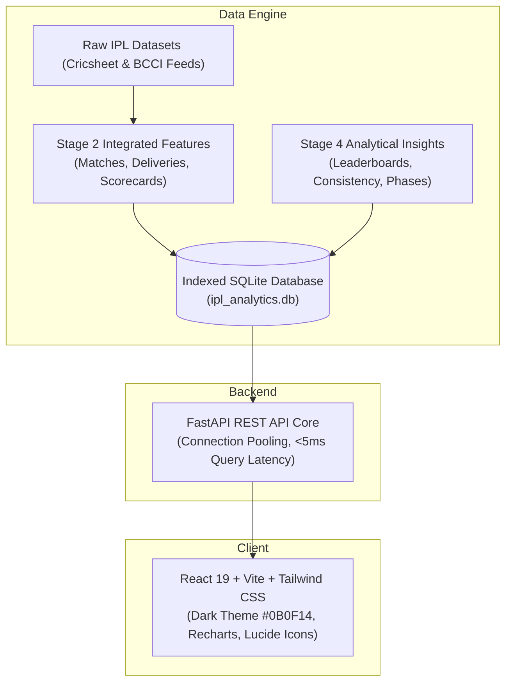

# 🏏 IPL Analytics Platform (2008 – 2026)

[](https://fastapi.tiangolo.com)
[](https://react.dev)
[](https://vitejs.dev)
[](https://tailwindcss.com)
[](https://python.org)
[](https://sqlite.org)

> **A professional sports technology SaaS application for exploring, visualizing, and analyzing Indian Premier League (IPL) cricket history.**
>
> Built with real, verified cricket data covering **19 seasons (2007/08 to 2026)**, **1,243 official fixtures**, and **295,732 ball-by-ball deliveries**.

---

## 📸 Key Features & Capabilities

- 🏟️ **Overview Dashboard:** Dynamic real-time KPI cards, all-time runs/wickets progression, top 10 batter & bowler charts, toss distributions, and highest team totals with multi-parameter filtering.
- 🛡️ **Team Analytics & Head-to-Head Engine:** Comprehensive franchise records, win percentages, defending vs chasing splits, season performance trends, and head-to-head battle simulations between any two teams.
- 👤 **Player Analytics & Career Profiles:** Instant autocomplete player search, milestone trackers (50s, 100s, 4w/5w hauls), career strike rates, bowling economies, and sortable all-time leaderboards.
- 🏆 **Match Explorer & Interactive Scorecards:** Filter through 1,243 fixtures by season, teams, venue, or Player of the Match. Full modal scorecards with over-by-over progression, fall of wickets, and extras breakdown.
- 📍 **Venue Analytics:** Pitch nature classification (Batting-Friendly, Bowling-Friendly, Balanced), average 1st and 2nd innings scores, and defend vs chase ratios across 53 stadiums.
- 📅 **Season Explorer:** Explore every championship from 2008 to 2026, including standings, Orange Cap and Purple Cap races, and side-by-side season comparisons.
- 📈 **Advanced Cricket Insights:** Macro phase dynamics (Powerplay vs Middle vs Death), chase probability models grouped by 1st innings target brackets, and player consistency analysis using Coefficient of Variation ($CV\%$).

---

## 🏗️ Architecture



---

## 🚀 Quick Start Guide

### Prerequisites
- **Python 3.10+**
- **Node.js 18+** & **npm**

### 1. Clone the Repository
```bash
git clone https://github.com/Deadshot2009/IPL-Analytics-Platform.git
cd IPL-Analytics-Platform
```

### 2. Build the SQLite Database
Compile the indexed database directly from the feature-engineered datasets:
```bash
python build_db.py
```
*(Takes ~4 seconds to build and index 295K rows).*

### 3. Install Backend Dependencies & Start Server
```bash
pip install fastapi uvicorn pandas
python backend/server.py
```
The backend starts at `http://127.0.0.1:8000`.

### 4. Run Frontend (Development)
In a separate terminal:
```bash
cd frontend
npm install
npm run dev
```
Open `http://localhost:5173` in your browser.

*(Or run production build directly from FastAPI at `http://127.0.0.1:8000`).*

---

## 📊 Dataset Inventory & Schemas

Detailed dataset dictionary and primary keys are documented in [`PROJECT_DATA_DICTIONARY.md`](./PROJECT_DATA_DICTIONARY.md).

| Dataset | Grain | Records | Description |
|---|---|---|---|
| `base/matches.csv` | Match | 1,243 | Match metadata, toss, result, innings totals, winner |
| `base/deliveries.csv` | Ball | 295,732 | Ball-by-ball events, runs, extras, wickets, phase, dots |
| `base/batter_scorecard.csv` | Batter-Innings | 18,837 | Individual batting performances and strike rates |
| `base/bowler_scorecard.csv` | Bowler-Innings | 14,734 | Bowling figures, economy rates, dots, maidens |
| `analytics/match_phase_features.csv` | Phase | 7,338 | Phase breakdown (Powerplay, Middle, Death) per innings |
| `stage4/player_batting_leaderboard.csv` | Career | 738 | Career batting aggregates and averages |
| `stage4/player_bowling_leaderboard.csv` | Career | 577 | Career bowling totals and wickets |

---

## 🎨 Visual Identity

| Property | Value | Preview |
|---|---|---|
| **Background Primary** | `#0B0F14` | Dark Sports Canvas |
| **Card Background** | `#151B24` | Surface Elevation |
| **Secondary Background** | `#1B2430` | Hover & Controls |
| **Primary Accent** | `#FF6B35` | IPL Fiery Orange |
| **Secondary Accent** | `#A3E635` | Electric Lime |
| **Border Color** | `#283241` | Subtle Divider |

---

## 📜 License

This project is licensed under the MIT License.
